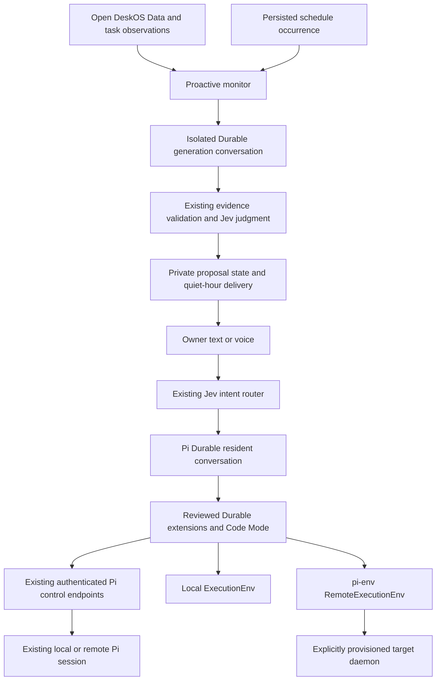

# Personal Agent design research

Research date: 2026-10-15. This document records source findings and the proposed migration.
It does not certify deployed behavior.

## Required result

The Personal Agent must offer useful suggestions without a user message.
It must control explicitly configured local and remote Pi sessions.
Its resident conversation runtime must use Pi Durable 1.4.0.
It must use applicable Pi extensions, including `pi-env`, instead of duplicating their functions.
CM5, Windows x64, and macOS remain supported Shell Hosts.

Read @CONTRACT.md for current authorization, proposal, and task-control contracts.
Read @../../../runtime/shell/CONTEXT.md for product terms.

## Research method

Searches covered personal assistants, heartbeat monitors, scheduled agents, remote execution, memory, and durable workflows.
The survey read first-party repository READMEs for 24 projects.
The current Pi API check uses installed 1.4.0 manifests, README examples, and exported types.
Search results helped find sources. Repository documentation supplied the evidence.
Repository claims are not independent runtime verification.
No repository ranking depends on stars or benchmark claims.

## Repository survey

Each design implication below is an Open DeskOS proposal, not an upstream compatibility claim.

| Project and source | Observed design | Open DeskOS implication |
| --- | --- | --- |
| [Pi Durable](https://github.com/earendil-works/pi/blob/v1.4.0/packages/durable/README.md) | Commits conversations, submissions, tasks, and tool results. Unsafe interrupted tools do not rerun. | Use its Harness as the resident runtime. Preserve uncertain external outcomes. |
| [Pi env](https://github.com/earendil-works/pi/blob/v1.4.0/packages/env/README.md) | Remote ExecutionEnv over a framed daemon connection. Storage and provider credentials stay local. | Use one durable runtime with explicit execution targets. Keep remote connectivity separate from session control. |
| [Pi chat](https://github.com/earendil-works/pi-chat/blob/main/README.md) | Channel workspaces, shared memory, scoped Skills, and Gondolin micro-VMs. | Separate conversation contexts and share only owner-approved data. |
| [OpenClaw](https://github.com/openclaw/openclaw/blob/main/docs/gateway/heartbeat.md) | Scheduled heartbeat, owner-routed alerts, silent replies, active hours, and busy deferral. | Make quiet operation normal. Do not infer recurring permission from chat history. |
| [NanoClaw](https://github.com/nanocoai/nanoclaw/blob/main/README.md) | Container isolation, agent workspaces, scheduled tasks, and script gates. | Check cheap conditions before a model wake. Report execution and delivery separately. |
| [nanobot](https://github.com/HKUDS/nanobot/blob/main/README.md) | Persistent conversations, long-horizon goals, scheduled automations, MCP, and Skills. | Keep goals distinct from schedule occurrences and conversation turns. |
| [Letta Code](https://github.com/letta-ai/letta-code/blob/main/README.md) | Agent identity, persistent memory, Channels, remote environments, and schedules. | Preserve identity across restarts. Keep owner memory separate from current measurements. |
| [LettaBot](https://github.com/letta-ai/lettabot/blob/main/README.md) | Unified memory and heartbeat. The README redirects new development to Letta Code. | Use historical design evidence only. Do not adopt this retired integration. |
| [OpenFang](https://github.com/RightNow-AI/openfang/blob/main/README.md) | Autonomous Hands bundle manifests, playbooks, Skills, and approval gates. | Package proactive capabilities with explicit inputs, tools, and delivery policy. |
| [CoPaw](https://github.com/agentscope-ai/CoPaw/blob/main/README.md) | Personal assistant with channels, memory, recurring tasks, Skills, and Plugins. | Keep channel adapters outside agent decisions. Reuse declared capability catalogs. |
| [Jarvis](https://github.com/roiguri/jarvis-agent/blob/main/README.md) | Interactive and heartbeat scopes share memory. Heartbeat checks chat before notifying. | Isolate passive generation from execution. Avoid suggestions the owner already handled. |
| [LinkBuddy](https://github.com/JinchengGao-Infty/LinkBuddy/blob/main/README.md) | Background service with heartbeat, SQLite history, reminders, and Apple helpers. | Make proactive failures visible without blocking interactive requests. |
| [Personal Assistant](https://github.com/beranradek/personal-assistant/blob/main/README.md) | Serialized message queue, adapters, heartbeat, and file memory. | Serialize owner turns. Bound background resource use. |
| [BabyClaw](https://github.com/babyclaw/babyclaw/blob/main/README.md) | SQLite state, timezone schedules, overlap prevention, and active-hour heartbeat. | Persist schedule occurrences and prevent concurrent duplicate wakes. |
| [Mitra](https://github.com/bipulluitel/mitra-ai-assistant/blob/main/README.md) | Local model, Letta memory, directives, heartbeat, and channel notifications. | Include explicit owner goals in proactive context. Record each wake outcome. |
| [MIRA](https://github.com/Vexillon-ai/MIRA/blob/main/README.md) | Local agent, quiet-hour check-ins, daily briefing, accounts, and audit trail. | Give suggestions provenance and owner controls. Keep missing sources unavailable. |
| [Automatos](https://github.com/AutomatosAI/automatos-ai/blob/main/README.md) | Board work queues, scheduled routines, model routing, and cost accounting. | Record generation cost and delivery outcome separately. Do not equate a task state with verified success. |
| [LangGraph](https://github.com/langchain-ai/langgraph/blob/main/README.md) | Durable execution, memory, and human intervention. | Borrow checkpoint semantics. Keep Pi Durable as the required runtime. |
| [Mem0](https://github.com/mem0ai/mem0/blob/main/README.md) | Separate personalization memory layer with user, session, and agent scopes. | Retain explicit owner memory authorization. Add retrieval only for a measured need. |
| [Graphiti](https://github.com/getzep/graphiti/blob/main/README.md) | Temporal knowledge graph for changing facts and relationships. | Retain observation timestamps. A graph database is not required for the initial migration. |
| [Goose](https://github.com/aaif-goose/goose/blob/main/README.md) | Native agent with provider adapters and MCP extensions. | Reuse tool adapters. Do not require a second agent harness. |
| [AionUi](https://github.com/iOfficeAI/AionUi/blob/main/README.md) | Desktop agent control, remote access, and scheduled automation. | Keep monitoring separate from authenticated control. Preserve session identity across surfaces. |
| [Activepieces](https://github.com/activepieces/activepieces/blob/main/README.md) | Integration-oriented automation platform. | Keep connector lifecycle outside the resident conversation. |
| [Trigger.dev](https://github.com/triggerdotdev/trigger.dev/blob/main/README.md) | Durable tasks, queues, idempotency, schedules, and realtime progress. | Give each trigger a stable occurrence ID. Bound retries by side-effect policy. |
| [Temporal TypeScript SDK](https://github.com/temporalio/sdk-typescript/blob/main/README.md) | Durable orchestration SDK. | Borrow recovery principles without adding another workflow service. |

The table contains 25 rows because the Pi repository contributes two separately reviewed packages.

## Proposed architecture

The resident agent coordinates owner requests and proposals.
Execution environments determine where tools run. They do not grant control over an existing terminal session.
Existing control endpoints retain their identity, authentication, and receipt contracts.
The proactive generator receives bounded observations and owner goals. It receives no action tools.
The host validates evidence, applies quiet hours, records deduplication, and publishes eligible suggestions.
An accepted suggestion follows the existing exact subsequent-turn confirmation contract.

## Pi 1.4 integration map

| Pi component | Intended use | Integration rule |
| --- | --- | --- |
| `pi-durable` Harness | Resident and proactive conversations, submissions, task graph, and usage | Pin 1.4.0. Use persisted storage for resident state. |
| Durable JSONL storage | Portable host-owned conversation state | Use a new private directory. Preserve legacy Coding Agent session files. |
| `pi-ai` Models | Provider routing and model credentials | Reuse operator provider configuration. Do not copy provider keys to remote hosts. |
| `chord` Context | Cancellation, committed views, and extension contracts | Cancelling a wait does not abort work. Abort the conversation explicitly. |
| Durable Code Mode and `pi-codemode` | Sandboxed orchestration and nested tool journals | Disable auxiliary models for the coordinator. Keep mutations sequential. |
| Durable tools | Environment-backed file and process operations | Offer read-only inspection to the coordinator. Give workers their authorized tool surface. |
| `pi-env` | Local daemon features and remote execution | Validate explicit targets and host keys. Provisioning needs separate authorization. |
| Durable tool search | Deferred discovery for large reviewed catalogs | Discovery does not grant authority. Intent and tool guards still apply. |
| Durable sections and hooks | Identity, instructions, Skills, tool gates, and audit | Port each required hook deliberately. Do not assume Coding Agent hook parity. |
| Pi MCP integration | Operator-reviewed external tools | Adapt declared schemas into Durable tools. Preserve connector authorization and lifecycle. |
| Pi Coding Agent | Existing Hosted Pi sessions during migration | Keep its public task contract until Durable worker parity is verified. |

Pi packages, Coding Agent extensions, and Durable extensions have different entry points.
Installing a package does not prove that a Durable conversation loaded its tools or hooks.
The [Durable extension API](https://github.com/earendil-works/pi/blob/v1.4.0/packages/durable/src/harness/types.ts) defines the conversion boundary.

## Recovery requirements

Give each owner request and schedule occurrence a stable request ID.
Persist admission before reporting acceptance.
Use replay-safe declarations only for operations that can safely run again.
Treat read-only hints as catalog metadata, not proof of replay safety.
Keep side-effecting tools unsafe unless their external service enforces idempotency.
Do not replay a lost prompt, purchase, installation, or deployment result.
Resume durable model work without restoring transient user authorization.
Pending action recovery must reconcile its existing receipt before another mutation.
Record silent, deferred, rejected, delivered, interrupted, and unknown outcomes distinctly.

## Acceptance and remaining work

| Requirement | Evidence required |
| --- | --- |
| Durable resident runtime | Production construction uses Harness 1.4.0. Restart retains conversation and request identity. |
| Proactive suggestions | A configured goal produces evidence-backed advice without an owner turn. Quiet hours and deduplication survive restart. |
| Local Pi control | Start, list, status, history, prompt, cancel, and end preserve existing receipts and identity. |
| Remote Pi control | The same operations use an authenticated configured endpoint. Disconnection retains unknown admission without replay. |
| Remote execution | A real `pi-env` connection reads and executes on the selected target. Local storage remains on the Shell Host. |
| Plugin use | Registered extensions execute through the actual Durable nested tool pipeline. Discovery cannot bypass guards. |
| Recovery safety | Process interruption tests show safe reads can resume and interrupted mutations do not run twice. |
| Host support | Independent Linux, Windows x64, and macOS checks pass. CM5 and Windows interactive evidence stays separate. |

### Candidate implementation and offline evidence

The current candidate pins Coding Agent, Durable, env, AI, Code Mode, and Chord to 1.4.0.
`src/durable-runtime.mjs` opens a real Harness with private JSONL storage and reviewed capability adapters.
`src/durable-storage.mjs` rejects linked files and holds one storage lease for the runtime lifetime.
Storage operations validate private file handles. Appended commit data is flushed before completion.
A stopped process leaves a lease that expires after 120 seconds.
Every host must use the same lease policy.

Offline tests cover persisted conversations, request deduplication, nested structured results, intent guards, and interruption recovery.
They also cover live cross-process contention, forced process termination, and setup-failure ownership release.
The forced-termination fixture advances only its stopped process's lease timestamp.
It proves recovery behavior, not elapsed lease timing or power-loss recovery.
LocalExecutionEnv reads files and uses the actual daemon for file listing.
RemoteExecutionEnv performs file and argv operations through a local daemon protocol fixture.
The separate [SSH acceptance](#ssh-acceptance) verifies the real loopback SSH transport and strict host-key checks.
These fixtures do not prove cross-machine execution or device deployment.

Both resident profiles now construct the Durable session port by default.
Proposals, home briefings, and proposal phrasing use isolated in-memory Durable conversations without tools or owner history.
The production monitor test generates a proposal without an owner turn and preserves delivery deduplication after restart.
Owner conversation tests retain history across restart and import legacy projected context once without changing legacy files.
They exercise actual Code Mode, structured results, direct-call compatibility, exact-turn memory guards, streaming, cancellation, and asynchronous shutdown.
Recovery checks prevent old submissions from borrowing new owner authorization.
The [runtime contract](CONTRACT.md#durable-runtime) owns these implementation details.

An offline native Pi handoff test drives an existing SDK session through the Durable coordinator.
It covers idle prompts, follow-up, steering, identity retention, and unknown-delivery receipts without creating replacement sessions.
Its model and Jev responses are deterministic fixtures.
It proves integration behavior, not live provider quality or physical device control.
The complete offline integration suite and related Shell checks pass on macOS.
Targeted runtime tests and typechecking also pass in an isolated Linux arm64 container with frozen dependencies.
The container does not prove CM5 hardware behavior.

Hosted Pi workers retain Coding Agent and their existing task-control contract.
RemoteExecutionEnv is not selectable for resident inspection; remote Pi sessions use the existing authenticated control endpoints.
Large-catalog tool search, new MCP connectors, and additional remote environment selection remain proposed extensions.

Real-model generation, cross-machine execution, and independent CM5 and Windows acceptance remain unverified for this candidate.
Deployment, service activation, real capture, and live acceptance require separate authorization.

### SSH acceptance

Run `pnpm test:env:ssh` from `integrations/personal-agent` to verify the isolated SSH path.
The runner requires `uv`, Python 3.11 or later, and the OpenSSH client.
`uv` installs the fixture's pinned [AsyncSSH](https://asyncssh.readthedocs.io/en/stable/#server-examples) dependency in an isolated environment.
The fixture listens only on `127.0.0.1` and generates temporary client and host keys.
It accepts only the test client, the installed Pi daemon command, and a fixed task-control query fixture.
It installs no system service and uses no provider credentials or real model requests.

The test uses Pi's `sshArguments`, `Connection`, RemoteExecutionEnv, and Durable read tool.
The client environment contains a test value that its SSH configuration selects through `SendEnv`.
A negative control proves that the unfiltered connection forwards this value before daemon startup.
The application's connection wrapper removes provider environment values before it starts SSH.
It checks target file writes, process working directory, and exclusion of a client-only environment value.
It also sends a correlated task-control query through the coordinator's direct SSH path with the same environment protection.
It also checks client-side conversation storage and rejection of unknown or changed host keys before daemon execution.
The test closes its connections and removes its temporary files.
The SSH acceptance passes on macOS and in a Linux arm64 container.
It proves a loopback SSH connection, not cross-machine, Windows, or physical-device acceptance.
